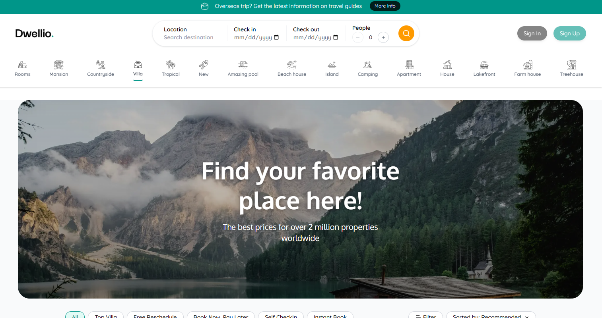
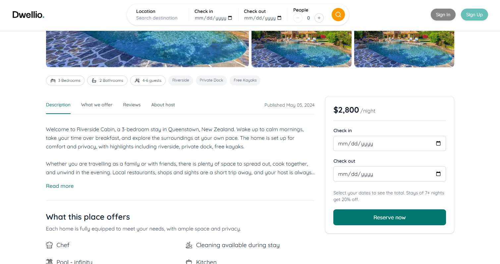
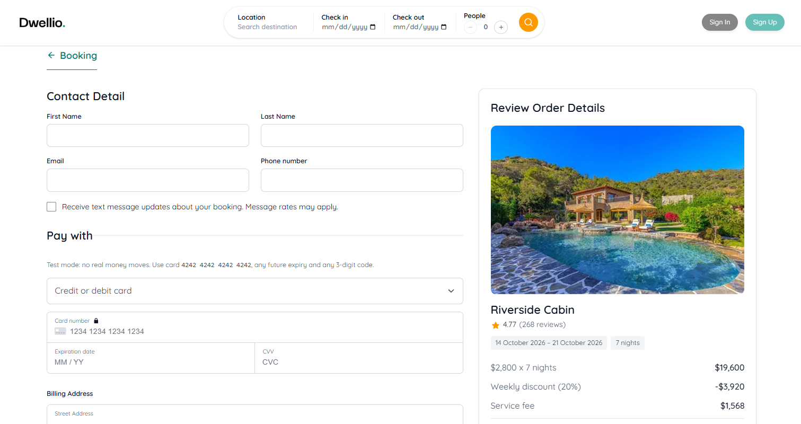
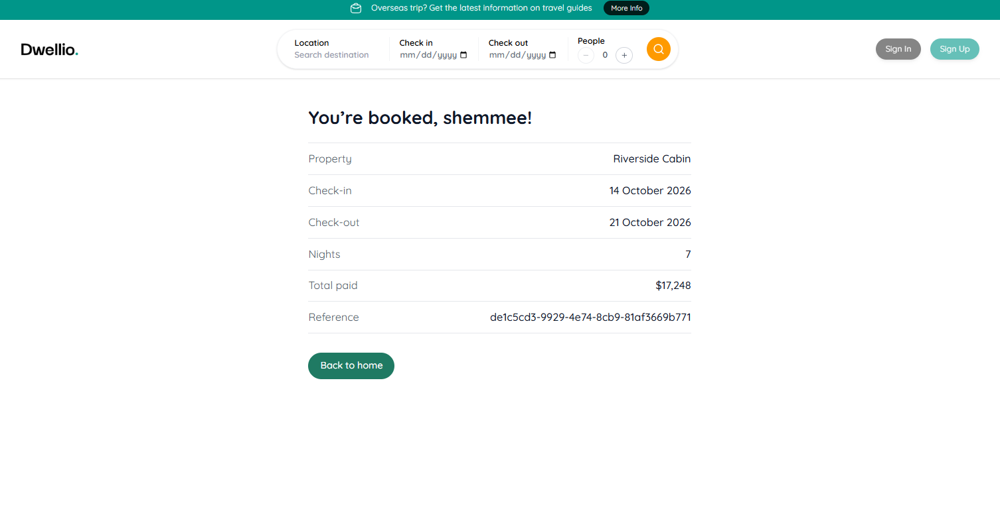

<div align="center">

# Dwellio

**A full-stack vacation rental booking app, built with Next.js, MongoDB and Stripe.**

[](https://nextjs.org/)
[](https://www.typescriptlang.org/)
[](https://tailwindcss.com/)
[](https://www.mongodb.com/atlas)
[](https://stripe.com/)
[](./LICENSE)

[Live demo](https://dwellio-shemmee.vercel.app) · [Report a bug](https://github.com/s-shemmee/Dwellio/issues) · [Request a feature](https://github.com/s-shemmee/Dwellio/issues)

</div>

## Overview

Dwellio is an Airbnb-style booking platform. Guests can browse properties, read details and reviews, choose dates with a live price breakdown, and pay by card. The project covers the full path from a UI built to a design spec to a payment-backed booking flow, with the server as the source of truth for prices and availability.

The live demo runs in **Stripe test mode**: no real payments are processed, and you can use the [test cards](#testing-payments) below.

## Screenshots

| Home                                    | Property detail                                               |
| --------------------------------------- | ------------------------------------------------------------- |
|  |  |

| Checkout                                        | Confirmation                                               |
| ----------------------------------------------- | ---------------------------------------------------------- |
|  |  |

## Features

- **Property pages:** image gallery, amenities, host information and paginated reviews
- **Pricing engine:** nightly rate, weekly discount, and service fee, shared between client and server. The server always recomputes the total and never trusts the client's value
- **Secure checkout:** card details are collected by Stripe Elements and never reach this server
- **Webhook-confirmed bookings:** a booking is confirmed only after Stripe reports a successful payment, and the payment is automatically refunded if the dates were taken in the meantime
- **Date holds:** pending bookings reserve their dates and expire through a MongoDB TTL index if unpaid
- **Accessibility and responsiveness:** keyboard navigation, labelled controls, screen-reader status messages, and layouts for mobile through desktop

## Tech stack

| Area      | Technology                                                        |
| --------- | ----------------------------------------------------------------- |
| Framework | Next.js (Pages Router), React 19, TypeScript                      |
| Styling   | Tailwind CSS v4                                                   |
| Database  | MongoDB Atlas, official `mongodb` driver                          |
| Payments  | Stripe (`stripe`, `@stripe/stripe-js`, `@stripe/react-stripe-js`) |
| Hosting   | Vercel                                                            |

## Getting started

### Prerequisites

- Node.js 20.6 or newer
- A [MongoDB Atlas](https://www.mongodb.com/atlas) cluster (the free tier is enough)
- A [Stripe](https://stripe.com) account in test mode, and the [Stripe CLI](https://docs.stripe.com/stripe-cli)

### 1. Clone and install

```bash
git clone https://github.com/s-shemmee/Dwellio.git
cd Dwellio
npm install
```

### 2. Configure environment variables

```bash
cp .env.example .env.local
```

| Variable                             | Description                                 |
| ------------------------------------ | ------------------------------------------- |
| `MONGODB_URI`                        | MongoDB Atlas connection string             |
| `MONGODB_DB`                         | Database name (default: `dwellio`)          |
| `STRIPE_SECRET_KEY`                  | Stripe test secret key (`sk_test_...`)      |
| `NEXT_PUBLIC_STRIPE_PUBLISHABLE_KEY` | Stripe test publishable key (`pk_test_...`) |
| `STRIPE_WEBHOOK_SECRET`              | Webhook signing secret (`whsec_...`)        |

In Atlas, create a database user and add your IP address under **Network Access** before connecting. The application rejects live Stripe keys unless `STRIPE_ALLOW_LIVE=true` is set.

### 3. Seed the database

```bash
npm run seed
```

Inserts the sample properties and reviews. The script is idempotent and safe to re-run.

### 4. Forward Stripe webhooks

In a second terminal:

```bash
stripe login
stripe listen --events payment_intent.succeeded --forward-to localhost:3000/api/stripe/webhook
```

Copy the `whsec_...` value it prints into `STRIPE_WEBHOOK_SECRET`.

### 5. Start the development server

```bash
npm run dev
```

Open [http://localhost:3000](http://localhost:3000). Restart the server after changing `.env.local`.

## Usage

### Testing payments

Use any future expiry date, any CVC and any postcode.

| Card number           | Result                            |
| --------------------- | --------------------------------- |
| `4242 4242 4242 4242` | Payment succeeds                  |
| `4000 0000 0000 0002` | Card is declined                  |
| `4000 0025 0000 3155` | Requires 3D Secure authentication |

### How a booking works

1. The guest selects dates, and the server recomputes the price.
2. `POST /api/bookings` checks availability, creates a `pending` booking that holds the dates, and creates a Stripe PaymentIntent for the exact total.
3. The browser confirms the payment with Stripe Elements.
4. Stripe calls `/api/stripe/webhook` on `payment_intent.succeeded`, and the booking becomes `confirmed`. If the dates are no longer available, the payment is refunded automatically.
5. The confirmation page polls `/api/bookings/[reference]` until the status is final.

### Scripts

| Command         | Description                              |
| --------------- | ---------------------------------------- |
| `npm run dev`   | Start the development server             |
| `npm run build` | Create a production build                |
| `npm run start` | Serve the production build               |
| `npm run lint`  | Run ESLint                               |
| `npm run seed`  | Seed properties and reviews into MongoDB |

## Project structure

```
components/   UI components (booking, property, layout, shared)
constants/    Sample property data used by the seed script
interfaces/   Shared TypeScript types
lib/          MongoDB, Stripe, and booking/property data access
pages/        Routes and API endpoints
scripts/      Database seed script
styles/       Global styles and design tokens
utils/        Pricing engine, amenity icons, slug helper
```

## Deployment

The app is deployed on [Vercel](https://vercel.com).

1. Add the environment variables above to the Vercel project.
2. In the Stripe Dashboard, create a webhook destination for `payment_intent.succeeded` pointing at `https://<your-domain>/api/stripe/webhook`, and use its signing secret as `STRIPE_WEBHOOK_SECRET`.
3. Allow Vercel to reach Atlas under **Network Access**. Vercel's outbound IPs change, so this typically requires allowing all addresses; restrict the database user to the `dwellio` database with `readWrite` access.
4. Redeploy after changing variables, since `NEXT_PUBLIC_` values are embedded at build time.

## Roadmap

- [ ] Availability calendar that disables already-booked nights
- [ ] Working search filters and category navigation on the home page
- [ ] Booking confirmation emails
- [ ] User accounts and booking history
- [ ] Rate limiting on the bookings endpoint

## Contributing

Contributions are welcome, and the roadmap above is a good place to start.

1. Open an issue to discuss larger changes before starting.
2. Fork the repository and create a branch from `main`.
3. Follow the setup steps above to run the project locally.
4. Write commits in the [Conventional Commits](https://www.conventionalcommits.org/) style, for example `feat(booking): disable booked dates`.
5. Make sure the checks pass:
   ```bash
   npx tsc --noEmit && npm run lint && npm run build
   ```
6. Open a pull request describing what changed and why.

Please do not commit secrets. `.env.local` is git-ignored; only `.env.example` with placeholder values belongs in the repository.

## License

Distributed under the terms of the license in [LICENSE](./LICENSE).

## Author

**Shemmee** · [GitHub](https://github.com/s-shemmee)
